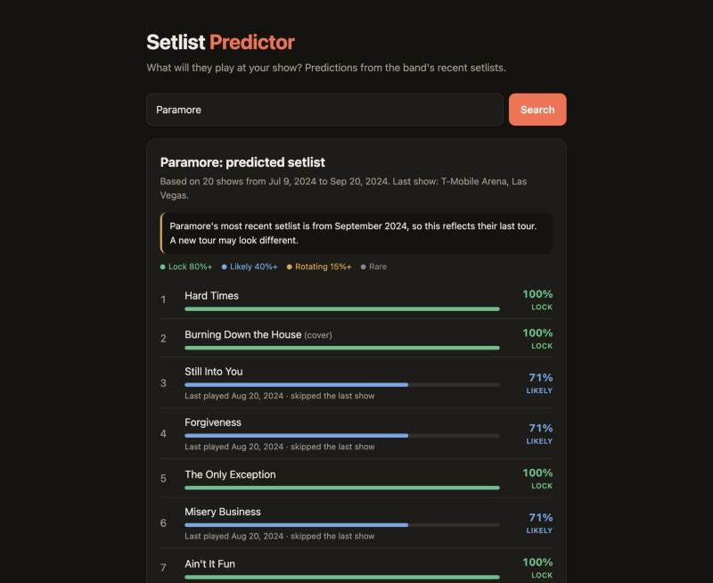
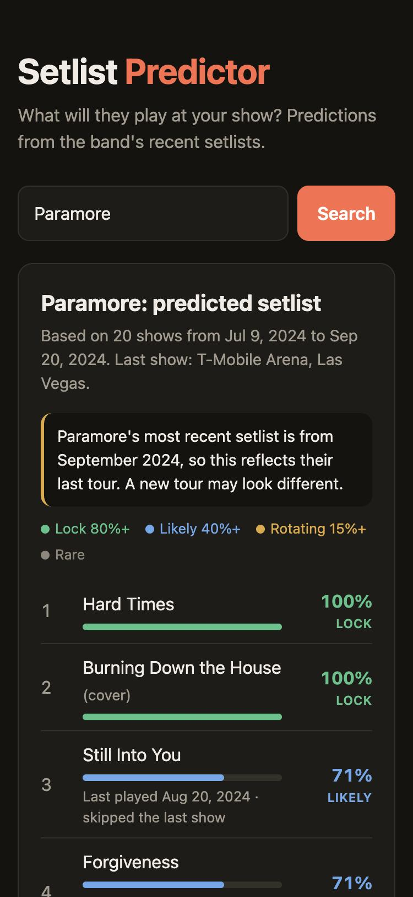

# Setlist Predictor

[](https://github.com/kinger56/setlist-predictor/actions/workflows/tests.yml)

**Live demo: [setlist-predictor.onrender.com](https://setlist-predictor.onrender.com)**
<sub>Hosted on Render's free tier: if nobody has visited in 15 minutes, the first load takes about a minute while the server wakes up.</sub>

Search for an artist and see what they'll probably play at your show: each song's chance of being played, the predicted setlist in running order, and how accurate those predictions have been on the band's real past shows.

<p align="center">
  
  &nbsp;
  
</p>

## Why I built it

<!-- Make this yours: add a sentence about the concert or moment that gave you the idea. -->
Before a concert, fans scroll through setlist.fm to guess what they'll hear. But 20 past setlists don't tell you at a glance which songs are near-certain, which rotate night to night, and which are a long shot. I wanted a tool that turns that history into probabilities, and that is honest about how often those probabilities turn out to be right.

## Features

- **Artist search** using live data from the [setlist.fm API](https://api.setlist.fm/docs/1.0/index.html)
- **Probability for every song**, shown as a bar and sorted into *lock* (80%+), *likely* (40%+), *rotating* (15%+) and *rare*
- **Predicted setlist in running order**, with encore songs placed last
- **Last-played dates** for songs the band has skipped recently
- **Accuracy check**: tests the model against the artist's own past shows
- **Old-data warning** when an artist hasn't toured in over six months
- Works on phones, and in light and dark mode

## How the prediction works

1. **Fetch** up to 20 of the artist's most recent setlists that have songs listed. Empty setlists for future shows are skipped.
2. **Score each song** by the share of recent shows that included it, with newer shows counting more. Each show's weight halves every 2 shows back:

   ```
   probability(song) = sum of weights of shows that included it / sum of weights of all shows
   weight of the show n shows ago = 0.5 ^ (n / 2)
   ```

   A song is counted once per show even if it was reprised. Titles are compared ignoring case and punctuation, so "Misery business" and "Misery Business" count as the same song.
3. **Choose how many songs** the show will have: the weighted average length of recent shows.
4. **Pick that many of the most likely songs** and put them in order by where they usually appear in the set. Songs that were in the encore at least half the time go last.

### How accurate is it?

The **backtest** goes back in time: for each past show, it makes a prediction using **only the shows before it**, then compares the prediction with what was actually played. Including the show being predicted in its own input would be data leakage and would inflate the score. A dedicated test checks that this can't happen.

Share of predicted songs that were actually played (precision), over 55 shows per artist:

| Artist | Every show weighted equally | Recency weighting (half-life 2, the default) |
|---|---|---|
| Coldplay | 90.4% | 89.2% |
| Taylor Swift | 88.8% | 88.7% |
| Paramore | 78.2% | **86.1%** |
| Olivia Rodrigo | 75.2% | **79.5%** |
| Bleachers | 72.4% | **77.1%** |
| Metallica | **63.9%** | 59.2% |
| Pearl Jam | **54.7%** | 50.8% |
| Phish | **8.7%** | 2.2% |

<sub>Measured October 2026 with `python -m scripts.tune`. Numbers change as new shows are added to setlist.fm.</sub>

**What this shows:** recency weighting helps artists who tour with a mostly fixed show, like Paramore and Bleachers. It makes no difference for artists whose show barely changes, like Coldplay and Taylor Swift. It **hurts** for bands that deliberately rotate their setlists, like Phish, Pearl Jam and Metallica. Those bands avoid repeating what they just played, so "played recently" actually means *less* likely. Phish, a jam band that almost never repeats a show, is close to unpredictable from frequency alone.

## Tech stack

| | |
|---|---|
| **Backend** | Python 3.12, FastAPI, httpx |
| **Data** | setlist.fm REST API, SQLite response cache |
| **Frontend** | HTML, CSS and JavaScript with no framework |
| **Testing** | pytest, Hypothesis (property-based tests), pytest-cov |
| **CI/CD** | GitHub Actions runs the tests on every push; Render deploys only commits that pass |

## Engineering decisions

- **Pure prediction logic.** `predictor.py` and `backtest.py` make no network calls and do no I/O, so they're quick to test and easy to reason about. Only `setlistfm.py` knows about HTTP.
- **Being polite to the API.** Responses are cached in SQLite for 12 hours, requests are spaced at least 0.6 s apart, and temporary failures (429 and 5xx errors) are retried with exponential backoff. The rate limiter is thread-safe, because FastAPI handles requests on several threads at once.
- **Untrusted data stays harmless.** setlist.fm is edited by fans, so setlists with missing dates are skipped instead of crashing the request. All text is put on the page with `textContent`, never `innerHTML`, which prevents script injection (XSS).
- **Secrets stay out of git.** The API key is read from an environment variable: from `.env` locally (which git ignores) and from Render's dashboard in production.

## Run it locally

You'll need Python 3.12 or newer and a free [setlist.fm API key](https://www.setlist.fm/settings/api).

```bash
git clone https://github.com/kinger56/setlist-predictor.git
cd setlist-predictor
python -m venv .venv
source .venv/bin/activate        # Windows: .venv\Scripts\activate
pip install -r requirements-dev.txt
cp .env.example .env             # then put your setlist.fm API key in .env
uvicorn app.main:app --reload
```

Open http://127.0.0.1:8000.

Command-line tools:

```bash
python -m scripts.explore "Paramore"                  # predicted setlist and every song's frequency
python -m scripts.tune "Paramore" "Phish" "Bleachers"  # backtest accuracy for different half-lives
```

## API

| Endpoint | Returns |
|---|---|
| `GET /api/artists?q=paramore` | Matching artists and their IDs |
| `GET /api/predict?mbid=<id>` | Predicted setlist, song probabilities and last-played dates |
| `GET /api/backtest?mbid=<id>` | Precision and recall on past shows, with and without recency weighting |
| `GET /api/health` | `{"status": "ok"}`, used by Render's health check |

Interactive docs are at `/docs` when the app is running.

## Tests

```bash
pytest -v
pytest --cov=app --cov-report=term-missing   # with a coverage report
```

71 tests cover 98% of the app code, and CI fails if coverage drops below 90%. The tests never touch the network: the API client is tested with a fake HTTP client, and the web routes with a fake setlist.fm client. Property-based tests in [`tests/test_predictor_properties.py`](tests/test_predictor_properties.py) generate hundreds of random setlist histories and check rules that must always hold, such as "every probability is between 0 and 1" and "the encore always comes after the main set".

## Project structure

```
app/
  setlistfm.py   setlist.fm client: caching, rate limiting, retries, JSON -> Show objects
  cache.py       SQLite response cache with expiry
  predictor.py   prediction logic (pure functions)
  backtest.py    accuracy measurement on past shows
  main.py        FastAPI routes
  static/        the web page
scripts/         command-line tools (explore, tune)
tests/           pytest suite, property-based tests, JSON fixtures
docs/            screenshots
render.yaml      Render deployment config
```

## What I'd add next

- **Pick the weighting per artist.** The backtest above shows that one setting doesn't fit every band. The app could backtest several half-lives for each artist and use whichever predicts best.
- **Model rotation for jam bands.** For artists like Phish, a song played last night should become *less* likely tonight.
- **Separate festival sets from headline shows.** A short festival set currently pulls the predicted length down.
- **Detect tour boundaries.** When a new tour starts, use only shows from that tour.
- **Shareable links**, like `?artist=paramore`, so a prediction can be sent to a friend.
